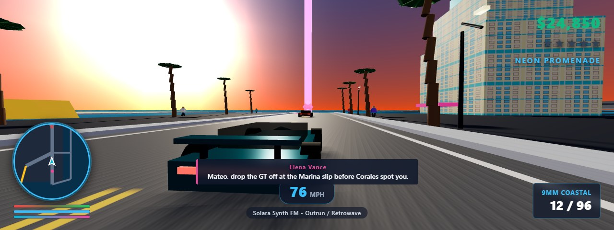
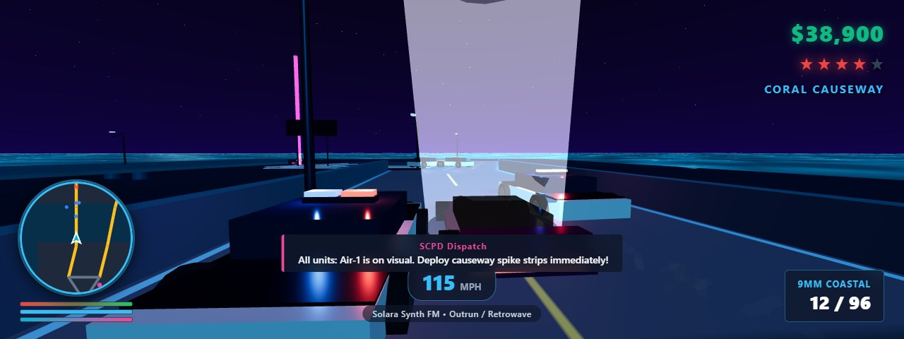
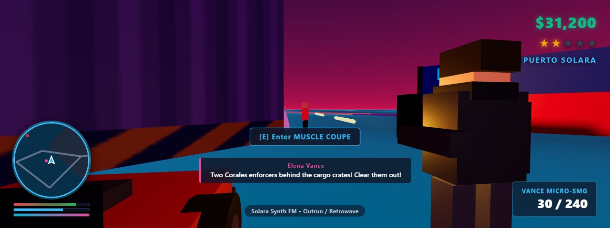
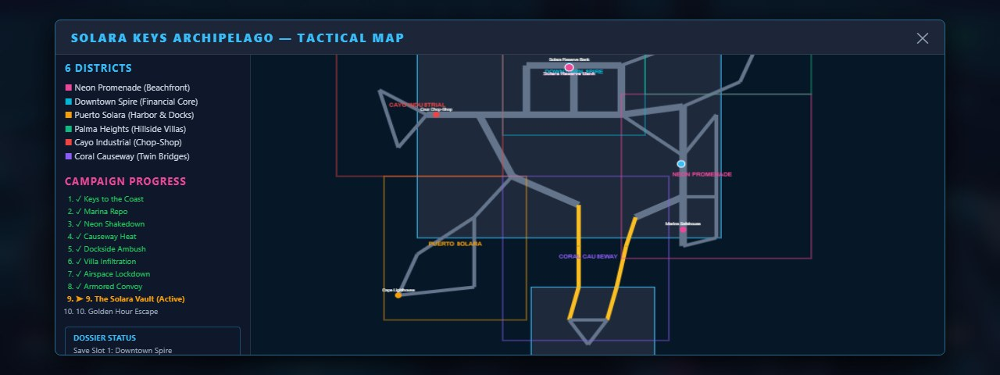

# SOLARA KEYS — 3D Open-World Crime Action

> **Make GTA 6 Bounty Entry (`gta6-01`)**  
> *100% Original 3D Open-World Crime Game built with Three.js*

[](LICENSE)
[](#)
[](#)

---

## Overview

**SOLARA KEYS** is a sun-soaked modern tropical-coastal crime metropolis set across a multi-island archipelago linked by twin ocean causeway bridges.

Play as **Mateo Cruz** (ex-marina stunt driver and mechanic) guided over encrypted comms by **Elena Vance** (heist strategist). Rise against rival syndicates (*Los Corales Cartel* and *Apex Harbor Security*) and evade the relentless *Solara Coastal Police Department* (SCPD) across a full 10-mission story campaign and dynamic side activities.

---

## 4 Genuine Browser Screenshots

| 01. Cover: Golden Hour Drive | 02. Coral Causeway Police Pursuit |
| :---: | :---: |
|  |  |
| **03. Dockside Infiltration Combat** | **04. Tactical Archipelago World Map** |
|  |  |

---

## 6 Archipelago Districts

1. **Neon Promenade (Beachfront Strip)** — Pastel Art-Deco hotels, glowing rooftop neon signs, palm-lined Ocean Drive, golden beach, and Marina Safehouse.
2. **Downtown Spire (Financial Core)** — Glass skyscrapers with reflective lit window grids, plazas, and the Solara Reserve Bank landmark.
3. **Puerto Solara (Harbor & Marina)** — Shipping cranes, cargo containers, docked speedboats, warehouses, and rotating coastal lighthouse.
4. **Palma Heights (Hillside Villas)** — Elevated scenic ridge roads, white luxury villas with infinity pools, and ocean sunset vistas.
5. **Cayo Industrial (Docks & Scrapyard)** — Fuel storage tanks, refinery pipes, industrial hangars, stunt jump ramps, and Cruz's Chop-Shop & Paint Garage.
6. **Coral Causeway (Twin Bridges & Keys)** — Elevated over-water highway bridges with glowing streetlamps and guardrails linking the mainland to outer keys.

---

## Controls

### On Foot
- `WASD`: Move
- `Shift`: Sprint
- `Space`: Jump
- `Mouse`: Look / Aim (Pointer Lock)
- `Left Click`: Fire weapon
- `R`: Reload
- `1` – `5`: Select Weapon (Fists, 9mm Pistol, Vance Micro-SMG, Tactical Shotgun, Pulse Carbine)
- `E` / `F`: Enter / Steal nearest vehicle or enter shop/safehouse

### Driving
- `W` / `S`: Accelerate / Reverse & Brake
- `A` / `D`: Steer
- `Space`: Handbrake / Drift
- `Shift`: Nitro Boost
- `E` / `F`: Exit Vehicle
- `Q`: Switch Radio Station (Solara Synth FM / Coral Bassline / Midnight Coast)
- `C`: Cycle Camera View

### Menus & Utilities
- `M`: Toggle Tactical World Map & Campaign Progress
- `T`: Cycle Time of Day (Golden Hour / Sunset / Neon Dusk / Midnight)
- `Esc`: Pause Menu / Save & Load Slots / Controls Guide

---

## Showcase Presets (Instant Live State Loading)

Load directly into genuine gameplay scenarios via URL query parameter:
- `game/index.html?preset=cover` — Golden hour Ocean Drive cruising with cyan Super GT and Marina beacon.
- `game/index.html?preset=chase` — 4-star high-speed Coral Causeway police pursuit with cruisers and chopper spotlight.
- `game/index.html?preset=combat` — Over-the-shoulder tactical shootout at Puerto Solara shipping docks.
- `game/index.html?preset=map` — Tactical full-screen world map with 6 district boundaries and campaign progression.

---

## Deterministic Build & Dossier Packaging

Running `node main.ts` executes the deterministic packaging pipeline:
```bash
# Uses Node.js 22.18+ (Node 22 / 24 / 26 native TypeScript execution)
node main.ts
```

This recursively copies `game/` and `screenshots/` to `process.env.MAKEFUN_OUTPUT_DIR || "/output"` and builds `/output/dossier.json` using `vendor/makefun-game.ts`. The output is guaranteed 100% byte-identical across consecutive sandbox runs.

---

## Offline Static Execution

`game/index.html` runs 100% offline in desktop Chrome without build steps, network access, or external CDNs. All 3D meshes, textures, audio synthesizers, shaders, and UI are generated entirely from scratch inside the codebase, using the locally vendored Three.js library (`game/vendor/three.module.min.js`).
